<p align="center">
  
</p>

<p align="center">
  <a href="https://github.com/Starktastic-Homelab/apps/actions/workflows/validate-and-diff.yml"></a>
  <a href="https://github.com/Starktastic-Homelab/apps/actions/workflows/refresh.yaml"></a>
  <a href="https://github.com/Starktastic-Homelab/apps/actions/workflows/image-scan.yml"></a>
</p>

This repository is everything that runs on the homelab's K3s cluster: 15 infrastructure apps and 61
services, each one a directory with an `app.yaml`. Argo CD finds the directories by itself, layers shared
values under every chart and brings the cluster up in four ordered waves. A route, single sign-on, a rate
limit and an uptime probe are a few lines in that `app.yaml`, not manifests written per app.

## Where it sits

<p align="center">
  
</p>

Ansible installs Argo CD with a root app that watches `bootstrap/` here. From then on Argo CD pulls `main`;
no workflow applies manifests. Ansible also writes the `KUBECONFIG_RAW` organization secret that
`refresh.yaml` uses, and seeds the Sealed Secrets key that `scripts/seal.sh` encrypts against. The
[organization profile](https://github.com/Starktastic-Homelab) shows the whole chain.

## How it works

### From Git to a running app

<p align="center">
  
</p>

Two ApplicationSets in `bootstrap/appsets/` create every Application. `cluster-apps` is a matrix of a list
(infrastructure, services) and a git generator, so a new directory with an `app.yaml` is a new app, with no
Application manifest to write. Its `templatePatch` reads the fields of that file and assembles the sources.
`config-apps` adds two fixed Applications: `base-configs` for storage objects and the backup CronJobs, and
`infra-configs` for shared routes, middlewares and certificates.

| Wave | Apps | What it brings |
|---|---|---|
| `crds` | 1 | The Prometheus operator CRDs, so later charts can ship monitors, probes and rules |
| `foundation` | 4 | Certificates, load balancer addresses, NFS volumes, secret decryption |
| `controllers` | 9 | Ingress, single sign-on, databases, CrowdSec, block storage, the GPU plugin, Reloader |
| `services` | 62 | The 61 services, plus Falco |

RollingSync turns automatic sync and self-heal off for these 76 Applications: Argo CD syncs them wave by
wave, and drift does not heal by itself. `base-configs` and `infra-configs` keep both. Every Application
prunes, so deleting a directory deletes its resources; storage objects opt out with `Prune=false` and
`Delete=false`.

### Value layers and variants

<p align="center">
  
</p>

Every chart loads `templates/globals.yaml` first, so a domain, a load balancer address or the NFS server
is written once. Services then load `templates/common.yaml`: most of them run on the bjw-s `app-template`
chart, so one file sets their time zone, user IDs, probe thresholds and default volume.

A variant is a second instance of an app. `radarr-ru` sets `baseApp: services/media/radarr`, reuses
radarr's `values.yaml` and adds a short file of its own with `valuesOverride: true`. Six apps are variants:
the five `-ru` media apps, and `homepage`, which is a variant of `homepage-admin`. When a base app changes,
`refresh.yaml` refreshes its variants too.

### One request, end to end

<p align="center">
  
</p>

`templates/ingress-chart` turns the `ingress` block of an `app.yaml` into a Traefik IngressRoute.

| `ingress` field | Effect |
|---|---|
| `domainType` | `public`, `media` or `internal` (the default): picks the domain, the entrypoint, and whether CrowdSec sees the request |
| `host` | The name under that domain; empty means the bare domain |
| `rateLimit` | Adds `rate-limit-strong`: 100 requests per second on average, bursts of 250 |
| `auth` | Adds `authentik-middleware`: forward auth to Authentik |
| `authAdmin` | With `auth`, swaps in `authentik-internal-gate`, an admins-only outpost for internal hosts ([ADR 0014](docs/adr/0014-internal-admin-gate.md)) |
| `probe` | Adds a blackbox `Probe` for the URL |

MetalLB announces one pool, `homelab`, of five fixed addresses: two for Traefik, and three that go straight
to Home Assistant and the two qBittorrent instances. TLS ends at Traefik with two wildcard certificates
that cert-manager gets from Let's Encrypt over DNS-01.

### Signals

<p align="center">
  
</p>

Prometheus selects every ServiceMonitor, PodMonitor, rule and Probe in the cluster, so an app adds
monitoring by shipping one object, and `ingress.probe: true` is enough for an uptime check. Alerts leave
the cluster two ways: as push messages through ntfy, and as a heartbeat. The always-firing `Watchdog` alert
pings healthchecks.io, which sends mail when the pings stop, so a dead Alertmanager is noticed from outside.

### Secrets, storage and decisions

- **Secrets are sealed offline.** `scripts/seal.sh` encrypts against `scripts/sealed-secrets-cert.pem`, and
  only the SealedSecret is committed. Ansible seeds the matching key at bootstrap, so the secrets in Git
  still decrypt after a cluster rebuild ([ADR 0004](docs/adr/0004-sealed-secrets.md)).
- **Every volume names its storage class.** Most use `proxmox-retained`: block volumes from Proxmox CSI
  with the `Retain` policy, bound to PersistentVolumes declared in `infrastructure/base-configs/`, so the
  link between a claim and its disk lives in Git. `nfs-pv` provisions shared folders on the NAS, and the
  media library is a static NFS volume. `local-path` stays the cluster default because k3s recreates it on
  every start, which is why no claim relies on the default
  ([ADR 0009](docs/adr/0009-explicit-storageclass-over-default.md)).
- **Decisions are written down.** [`docs/adr/`](docs/adr/README.md) holds 20 architecture decision records,
  from K3s over Talos to the admin gate.

## What is in the repo

| Path | What it holds |
|---|---|
| `bootstrap/appsets/` | The two ApplicationSets |
| `infrastructure/system/`, `infrastructure/controllers/` | The 15 infrastructure apps |
| `infrastructure/base-configs/` | PersistentVolumes and claims, and the PostgreSQL and certificate backup CronJobs |
| `infrastructure/configs/` | Shared IngressRoutes, middlewares, certificates and the Argo CD notification settings |
| `services/<category>/<app>/` | The 61 services: `app.yaml`, `values.yaml` and an optional `manifests/` |
| `templates/` | `globals.yaml`, `common.yaml`, `media-arr-common.yaml` and `ingress-chart/` |
| `homepage/` | The catalog and page sources behind the two dashboards |
| `scripts/` | `new-service.sh`, `seal.sh`, and the `check-*` policy checks that CI runs |
| `docs/` | `adr/`, `runbooks/`, `operations/` and these diagrams |

<details>
<summary><b>Infrastructure</b>: 15 apps</summary>

| App | Wave | What it provides |
|---|---|---|
| `prometheus-operator-crds` | crds | The monitoring CRDs |
| `cert-manager` | foundation | The `letsencrypt-prod` issuer, DNS-01 through Cloudflare |
| `metallb` | foundation | The layer 2 address pool `homelab` |
| `nfs-provisioner` | foundation | The storage class `nfs-pv` |
| `sealed-secrets` | foundation | Decrypts the SealedSecrets in Git |
| `traefik` | controllers | Ingress as a DaemonSet, with separate public and internal Services and entrypoints |
| `authentik` | controllers | Single sign-on, with the LDAP and admin-gate outposts |
| `postgres`, `redis`, `pgadmin` | controllers | The shared databases and their admin UI |
| `crowdsec` | controllers | Reads the Traefik logs and feeds the bouncer middleware |
| `proxmox-csi` | controllers | The storage class `proxmox-retained` |
| `reloader` | controllers | Restarts workloads when a ConfigMap or Secret changes |
| `intel-device-operator` | controllers | The Intel GPU device plugin |
| `falco` | services | Runtime security events; critical ones go to Alertmanager |

</details>

<details>
<summary><b>Services</b>: 61 apps in three categories</summary>

**Home automation (3):** `home-assistant`, `mosquitto`, `zigbee2mqtt`

**Media (33):** `audiobookshelf`, `autobrr`, `bazarr`, `calibre-web`, `cineplete`, `cleanuparr`,
`cross-seed`, `dispatcharr`, `flaresolverr`, `immich`, `jellyfin`, `libretranslate`, `lidarr`, `lingarr`,
`metube`, `navidrome`, `prowlarr`, `qbit-manage`, `qbit-manage-ru`, `qbittorrent`, `qbittorrent-ru`,
`radarr`, `radarr-ru`, `recyclarr`, `samsung-tvplus`, `seerr`, `seerr-ru`, `seerr-telegram-bot`,
`shelfmark`, `sonarr`, `sonarr-ru`, `subgen`, `unpackerr`

**Operations (25):** `alertmanager-ntfy`, `alloy`, `bytestash`, `changedetection`, `convertx`, `cyberchef`,
`excalidash`, `filebrowser`, `homepage`, `homepage-admin`, `karakeep`, `kube-prometheus-stack`, `listmonk`,
`loki`, `mealie`, `microbin`, `ntfy`, `pairdrop`, `paperless-ngx`, `postgres-enrollment-pilot`,
`prometheus-blackbox-exporter`, `searxng`, `stirling-pdf`, `tempo`, `vaultwarden`

</details>

## Workflows

| Workflow | Runs on | What it does |
|---|---|---|
| `validate-and-diff.yml` | pull request | yamllint, kubeconform and the policy checks (admin gate, alert policy, dashboard coverage, image digests and more), then an Argo CD diff preview as a comment |
| `refresh.yaml` | push to `main`, manual | On the self-hosted runner: finds the apps a commit touched and runs `argocd app get --refresh` for them. It never syncs |
| `format.yaml` | pull request | Prettier for YAML and JSON, shfmt for shell; commits the result to the branch |
| `image-scan.yml` | Mondays 06:00 UTC, manual | Trivy over every image a `values.yaml` references; findings go to the Security tab and never block a merge |
| `readme-images.yml` | pull request that touches Markdown or `docs/diagrams/` | Checks that every image a Markdown file references exists |

The refresh is scoped. A change to `templates/globals.yaml`, the ingress chart or `bootstrap/` refreshes
everything, and `templates/common.yaml` refreshes all services. A file under `services/` or
`infrastructure/` refreshes the app that owns it, and its variants when a base app's `app.yaml` or
`values.yaml` changed. Anything else, `templates/media-arr-common.yaml` included, refreshes nothing.

## Run it

```sh
# Scaffold a service: asks for name, category, image, port, ingress and storage (needs yq and docker)
./scripts/new-service.sh

# Seal a secret offline (needs kubectl and kubeseal); it writes <secret-name>.yaml
./scripts/seal.sh <secret-name> <namespace>

# See the route an app.yaml produces; a variant adds its own app.yaml after its base
helm template radarr-ru templates/ingress-chart -f templates/globals.yaml \
  -f services/media/radarr/app.yaml -f services/media/radarr-ru/app.yaml

# Lint, and render the shared configuration chart
YAMLLINT_CONFIG_FILE=.github/yamllint.yaml yamllint .
helm template configs infrastructure/configs -f templates/globals.yaml
```

To add a service:

1. Run `new-service.sh`. It pins the image digest and writes `services/<category>/<name>/app.yaml` and
   `values.yaml`.
2. Name a storage class on every volume the app adds.
3. Put sealed secrets and other extra objects in the app's `manifests/` and set `manifests: true`.
4. If the app has a route, add its tile to `homepage/catalog.yaml` and run
   `python3 scripts/homepage/generate.py`. CI fails when a host is missing from the admin dashboard.
5. Open a pull request and read the diff preview. After the merge the git generator picks up the new
   `app.yaml`, and the app joins the `services` wave.

## Operations

- [Operator notes](docs/operations/operator-notes.md): storage notes for Bazarr, ntfy, Grafana and pgAdmin,
  alert exclusions, probe paths, the FlareSolverr exception in Falco, and the alert policy check.
- [Storage runbooks](docs/runbooks/): storage and recovery, one file per app or group of apps.
- [Proxmox CSI](infrastructure/system/proxmox-csi/README.md): how retained block volumes are set up.
- [PostgreSQL enrollment](docs/operations/postgresql-enrollment.md) and its
  [qualification results](docs/operations/postgresql-enrollment-qualification.md).
- [Architecture decision records](docs/adr/README.md) and the [security policy](SECURITY.md).
- Backups: this repository dumps PostgreSQL and copies the TLS certificates to NFS every night. The host
  backup that takes them off-site, and every restore path, is in
  [ansible](https://github.com/Starktastic-Homelab/ansible/blob/main/docs/backup-and-restore.md).

---

<p align="center">
  Part of <a href="https://github.com/Starktastic-Homelab"><b>Starktastic Homelab</b></a>:
  <a href="https://github.com/Starktastic-Homelab/packer">packer</a> ·
  <a href="https://github.com/Starktastic-Homelab/terraform">terraform</a> ·
  <a href="https://github.com/Starktastic-Homelab/ansible">ansible</a> ·
  <a href="https://github.com/Starktastic-Homelab/apps">apps</a><br>
  <sub>Product logos in the diagrams are trademarks of their owners and are used only to label the components.</sub>
</p>
